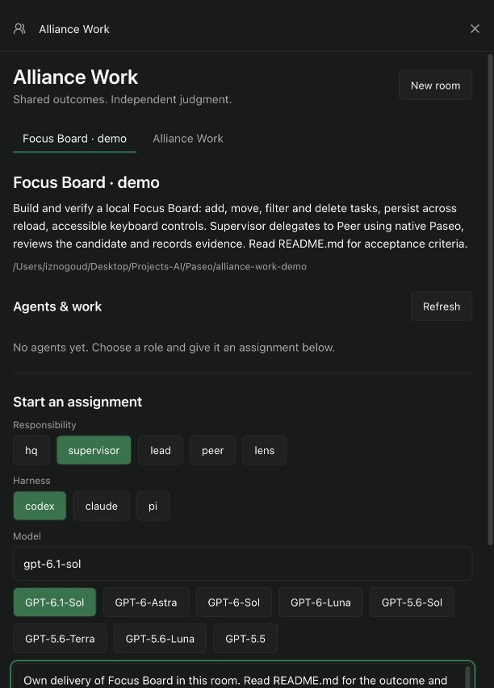
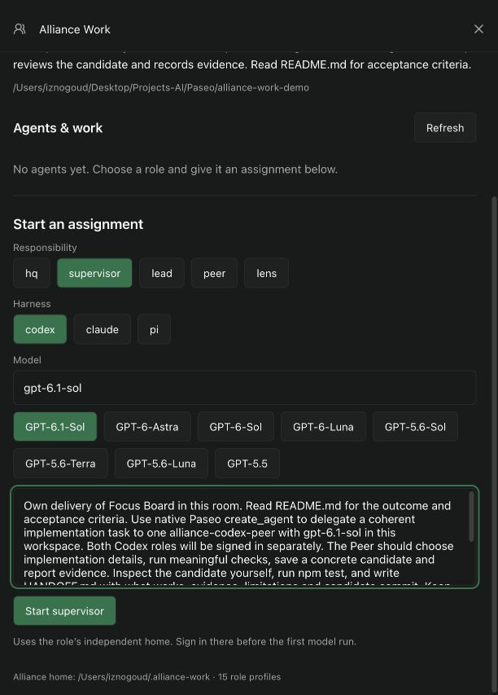
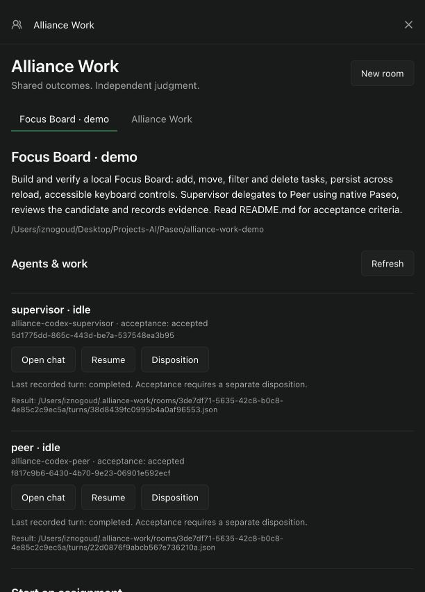
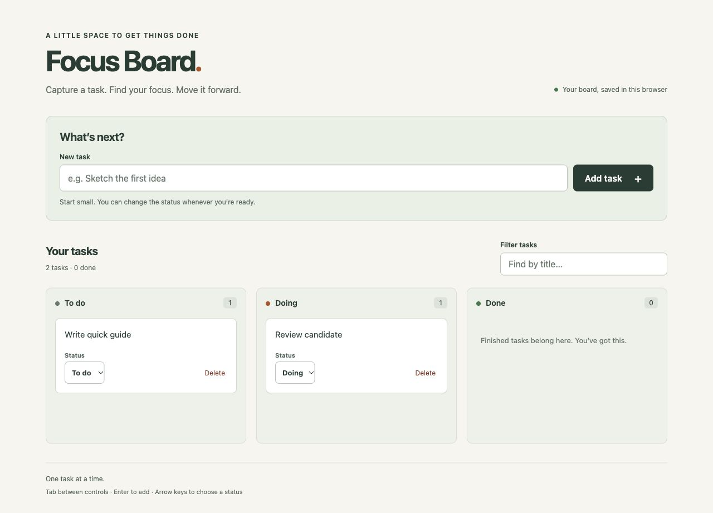

# Alliance Work — hướng dẫn nhanh

Bắt đầu bằng **một room, một Supervisor và một kết quả rõ ràng**. Agent tự chọn cách làm và gọi thêm role khi cần. Không phải tạo đủ năm role cho mỗi việc.

## 1. Cài đặt và kiểm tra auth

Làm phần [Install](../README.md#install), rồi kiểm tra:

```sh
alliance-work auth codex --from "$HOME/.codex"
alliance-work auth status
alliance-work doctor
```

Cả **HQ, Supervisor, Lead, Peer và Lens** dùng nguồn auth Codex này. Mỗi role vẫn có config,
skills, instructions và lịch sử riêng. Nếu auth nguồn hết hạn, làm mới đăng nhập ở Codex gốc rồi
tiếp tục; không cần login lại từng role. Xem [vận hành và auth](operations.md#authentication)
cho giới hạn refresh, đăng nhập riêng và Claude/Pi.

Mở [127.0.0.1:6771](http://127.0.0.1:6771) và chọn **Alliance Work**.

## 2. Tạo room cho project

Tạo thư mục project trước; có thể dùng một repository đang có. Trong **Alliance Work → New room**, nhập:

- **Room title:** tên dễ nhận biết, ví dụ `Focus Board`.
- **Project directory:** đường dẫn tuyệt đối đến thư mục project.
- **Room mission:** kết quả cần đạt, giới hạn và cách biết đã hoàn thành.

Bấm **Create room**. Một checkout chỉ có một room. Room và mission được lưu, vẫn còn sau khi tải lại trang.



## 3. Giao assignment đầu tiên

Ở **Start an assignment**, chọn role → harness → model. Với Codex dùng auth chung, mọi role đều nhận nguồn auth đã chọn. Với Claude/Pi hoặc Codex đăng nhập riêng, chuẩn bị auth cho các role sẽ tham gia.

| Role | Khi nào dùng |
| --- | --- |
| Supervisor | Chịu trách nhiệm kết quả của project, phân công và kiểm tra bàn giao |
| Lead | Phụ trách một nhánh công việc có phạm vi riêng |
| Peer | Thực hiện một nhiệm vụ, tự điều tra và quyết định kỹ thuật trong phạm vi đó |
| Lens | Đưa một góc nhìn hoặc đánh giá có bằng chứng |
| HQ | Điều phối ưu tiên và ranh giới giữa nhiều nhóm công việc |

Với bài thử này, chọn **supervisor → codex → GPT-6.1-Sol**. Assignment nên nêu **kết quả, phạm vi, bằng chứng**. Ví dụ:

> Đọc README.md và hoàn thành Focus Board trong project này. Giao một phần triển khai có ranh giới rõ cho một alliance-codex-peer qua native Paseo. Tự kiểm tra candidate của Peer, chạy npm test và ghi HANDOFF.md với kết quả, bằng chứng, giới hạn còn lại và commit. Chỉ sửa project này cùng artifact của room; không deploy. Được phép tự quyết định thiết kế và cách triển khai trong phạm vi trên.

Bấm **Start supervisor** để mở chat native. Assignment chỉ được lưu chính thức khi gửi; nội dung đang gõ trong form có thể mất khi tải lại trang. Bản assignment đầy đủ của demo được lưu riêng trong `alliance-work-demo/ASSIGNMENT.md` để dùng lại.



## 4. Theo dõi và tiếp tục

Trở lại room để xem các thành viên; **Open chat** mở cuộc hội thoại native của từng agent. **Refresh** đọc lại trạng thái.

**Resume → Continue assignment** dùng khi agent đã dừng hoặc đang idle và còn việc phải làm. Nếu có yêu cầu quyền đang chờ, xử lý trong chat trước. Khi agent còn chạy, dùng chat để chủ động điều chỉnh; không gửi lặp cùng một assignment.

Paseo có thể hiện yêu cầu quyền chạy tool hoặc lệnh trong chat. Kiểm tra thao tác và phạm vi assignment rồi chọn **Accept** cho lượt đó. Nếu Supervisor dùng `respond_to_permission` để xử lý quyền của Peer, có thể mở chat Peer để xem yêu cầu gốc.

Agent kết thúc một lượt chưa có nghĩa sản phẩm đã đạt yêu cầu. Đọc phần bàn giao, kiểm tra candidate và chạy các kiểm tra phù hợp với project.

## 5. Nghiệm thu đúng candidate

Mở **Disposition** ở thành viên chịu trách nhiệm bàn giao:

1. **Candidate identity:** commit SHA hoặc artifact cố định đang được đánh giá.
2. **Disposition evidence:** đã kiểm tra gì, kết quả ra sao, còn thiếu gì.
3. Chọn **Accept candidate** khi đạt; chọn **Reject candidate** nếu cần làm tiếp.

Một lượt làm việc mới mở lại trạng thái acceptance; quyết định trước vẫn được giữ trong artifact của room. Assignment, kết quả lượt chạy và quyết định nằm dưới `~/.alliance-work/rooms/<room-id>/`.



## Cập nhật

```sh
alliance-work update --check
alliance-work update
alliance-work doctor
```

Kết thúc agent và workspace script đang chạy trước khi update. Room, assignment và lịch sử được
giữ lại. Dùng `alliance-work setup --refresh` khi cần nạp lại asset từ phiên bản đang cài;
`alliance-work rollback` quay về bản cài trước. Xem [hướng dẫn vận hành](operations.md#updates-and-recovery).

## Demo Focus Board đã nghiệm thu

Project mẫu ở `~/Desktop/Projects-AI/Paseo/alliance-work-demo`, room **Focus Board · demo**.
Supervisor đã giao việc qua native Paseo cho Peer, nhận candidate, review và chạy lại **11/11 test**;
`npm start` cũng đã được kiểm tra. Host đã thao tác trên UI thật: thêm task, từ chối nội dung rỗng,
đổi trạng thái, lọc/xóa, reload giữ dữ liệu, dùng bàn phím và kiểm tra bố cục 390px/1280px.

- Candidate triển khai: `f20ebfb14bb9e95523ef28375012bfe84f17c76d`.
- Commit có `HANDOFF.md` hoàn chỉnh: `a589487e056efa30e0b3d35dd0f1e99fbea9b79f`; code ứng dụng giữ nguyên.
- Cả Peer và Supervisor đều **accepted** bằng Disposition riêng; trạng thái vẫn còn sau reload.



[Xem hoặc tải video demo](https://github.com/haohao3k/alliance-work/releases/download/v0.1.3/alliance-work-demo.mp4) · [Phụ đề tiếng Việt](https://github.com/haohao3k/alliance-work/releases/download/v0.1.3/alliance-work-demo.vi.vtt).
Video dùng các frame UI chụp thật, có phụ đề tiếng Việt; đã cắt thời gian chờ và các lượt cấp quyền lặp,
làm chậm một số thao tác ngắn để dễ theo dõi. Không phải bản ghi liên tục toàn phiên.
Repo private nên cần tài khoản GitHub có quyền truy cập. Có thể tải bằng CLI:

```sh
gh release download v0.1.3 --repo haohao3k/alliance-work --pattern alliance-work-demo.mp4
```

Bài này chạy model thật bằng **Codex Supervisor và Peer**. Claude/Pi đã được kiểm tra native home và
skill discovery, chưa chạy bài model acceptance này. Các kiểm tra UI không thay thế một audit
accessibility hoặc kiểm tra mọi trình duyệt. Auth và giới hạn refresh nằm trong [operations](operations.md#authentication).
