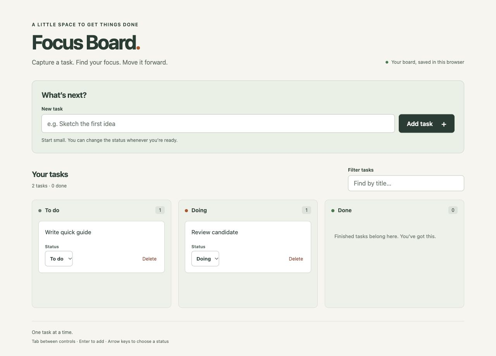

# Alliance Work

Mở project bằng giao diện native của Paseo, chọn profile **Alliance HQ / Supervisor / Lead / Peer / Lens**, rồi giao việc trong chat.

## Room tự động

Chưa có room cho thư mục thì Alliance tạo một room khi mở profile. Đã có thì dùng lại,
không đổi mission hay tạo bản sao. Worktree khớp duy nhất một room của repository cũng dùng lại
room đó. Nếu nhiều room cùng repository khiến việc chọn mơ hồ, thêm chính đường dẫn checkout
bằng **Alliance Work → Add project**.

**Add project** cho phép gõ `~/`, đường dẫn tuyệt đối, hoặc chọn thư mục trong danh sách.
Thư mục được đọc trên host đang chọn. Không cần nhập tên, mission hay assignment ở đây.

## Theo dõi

**Alliance Work** hiển thị agent theo project: tên, role, model, trạng thái và thời điểm cập nhật.
Chọn **Working**, **Attention**, **Idle**, lọc project hoặc tìm theo tên. **Open** mở đúng session
trên đúng host. **Archived** hiện thêm session đã lưu trữ. Bảng tự cập nhật; lỗi đọc hiển thị rõ
khi dữ liệu cũ vẫn còn trên màn hình.

Gửi việc mới, tiếp tục, xử lý permission và kiểm tra bàn giao trong chat native. Agent idle chỉ
có nghĩa không chạy lượt hiện tại; không đồng nghĩa công việc đã được nghiệm thu. Assignment,
kết quả và các quyết định cũ vẫn nằm dưới `~/.alliance-work/rooms/<room-id>/`.

Một owner chịu trách nhiệm giao phẩm đầy đủ; mặc định tự làm, chỉ dùng Peer có phạm vi rõ khi
có ích. Tự đánh giá ở mốc bàn giao, lỗi hoặc trước rerun phải chỉ ra bằng chứng và hành động
tiếp theo. Không tự hạ scope, tiêu chí, mẫu số, model hay budget để gọi là tiến bộ; kết quả âm
hoặc chưa kết luận vẫn phải giữ nguyên. Chỉ hỏi Human phần thực sự thiếu quyền, ý định hoặc
truy cập, đồng thời làm tiếp phần độc lập đã được phép.

Từ 0.1.30, timer tạo bằng `wait --minutes/--at` tự hết hiệu lực sau quyết định accept/reject.
Nghĩa vụ chưa xong vẫn hiện dù session bị archive. Mở lại native session khôi phục custody,
không tự chạy lại assignment đã park. Nếu model chọn khác model được báo gần nhất, bảng hiện
cả hai để đối chiếu. Nghiệm thu bundle phân tích dùng `accept --analysis-root` trong phạm vi
artifact của room; xem [điều kiện và giới hạn](operations.md#handback-waiting-and-reminders-0119).

## Model theo room

Mở **Alliance Work → Models** ở project cần chỉnh. Chọn **Peer list** hoặc **Lens list**: mỗi
vai có danh sách riêng, số 1 là lựa chọn đầu tiên. Thêm model/effort từ catalog thật vào vai
đang chọn, bỏ route không muốn dùng, chỉnh thứ tự, hoặc giới hạn một route vào vài mức độ khó.
**Save model settings** lưu riêng cho room trên host đó; màn hình ghi rõ room đang dùng mặc định
của bản phát hành hay bản đã lưu. **Reset defaults** chỉ sửa bản nháp, cần Save mới áp dụng.
Muốn room quay lại theo mặc định của bản phát hành (kể cả các lần cập nhật sau), chạy
`alliance-work models reset --room ID` (hoặc `--all`); `alliance-work models show` xem danh sách.

Mặc định từ 0.1.18:

| Vai | Thứ tự (cao → thấp) |
|---|---|
| Peer | claude Sonnet 5.5 high → claude Sonnet 5.5 medium → codex gpt-6.1-sol high → agy gemini-4-argon-medium → pi zai/glm-5.3 high → pi izno-vps/ds/deepseek-v4.1-flash high |
| Lens | claude Opus 5.5 medium → codex gpt-6-astra medium → agy gemini-4-argon-high |

Lead chọn route cuối cùng trong danh sách của vai đó, đi từ trên xuống, bỏ qua route không có
trong catalog hoặc hết quota và ghi lý do; Supervisor/HQ có thể can thiệp bằng lý do và bằng
chứng. Không có classifier tự đọc prompt để định độ khó, và không tự đổi model đang chạy.
HQ/Supervisor/Lead giữ lựa chọn model độc lập với danh sách Peer/Lens.

HQ/Supervisor/Lead không ghi model thì dùng **GPT-6.1 Sol hoặc Claude Sonnet 5.5**; được chọn
tường minh model/effort khác trong catalog thật (Astra/Opus khi task cần, ghi lý do). Đây không phải
điều kiện chặn tạo owner; danh sách Peer/Lens không giới hạn model của owner. Settings cho chỉnh effort ưu tiên khi không chỉ định.
Nếu model không hỗ trợ effort ưu tiên thì dùng mặc định khả dụng của model. Model/effort được
chọn tường minh nhưng không có trong catalog vẫn báo lỗi, không tự đổi ngầm.

Gate kiểm tra mọi lượt **tạo agent Alliance** qua UI/native `create_agent` và RPC, kể cả khi
Human tự tạo. Peer/Lens phải khớp đúng harness, model và effort trong danh sách của vai đó.
RPC `members.launch` có `difficulty` thì kiểm tra thêm mức độ khó. Bỏ model sẽ lấy route đầu
tiên còn khả dụng của harness đó; bỏ effort sẽ lấy route đầu tiên của model đó. Khi bị từ chối,
lỗi liệt kê các route room cho phép và chỉ chỗ sửa.

Settings áp dụng cho **launch mới**. Phiên đang mở giữ context cũ; SDK Paseo hiện chưa có hook
chặn đổi model/effort ngay trong phiên. Khi đổi policy, owner cần bàn giao assignment sang phiên
mới; không coi đây là giới hạn chi phí cưỡng chế cho mọi lệnh native/harness. Không tự ngắt phiên.

Policy chung của Alliance nằm trong `room/policies/agent-ownership.md`, `operating-contract.md`
và `model-selection.md`, được nạp cho mọi role. Đây là phần tương đương general policy; vendor
Seatwork giữ nguyên. [Nguyên tắc chọn model và nguồn OpenAI/Anthropic](../room/policies/model-selection.md).

## HQ nhiều host

Workspace HQ giữ danh bạ host và các con trỏ project. HQ dùng Paseo CLI với `--host` để đọc
trạng thái và message, rồi giao việc trong phạm vi Human đã giao. Native Paseo MCP thao tác trên
host của session. Luôn ghi cả host và agent ID; host mất kết nối là chưa biết trạng thái.
HQ có thể dùng Piggery CLI cho project dùng Piggery, nhưng không tự coi mình đã có participant ID.

## Auth và cập nhật

```sh
alliance-work auth status
alliance-work doctor
alliance-work update --check
alliance-work update
alliance-work deploy --host ryzen --host i5 --host build-mac --remember  # từ máy có gh
alliance-work deploy --wait-idle 240 --detach   # lần sau: dùng lại danh sách máy đã lưu
alliance-work deploy --wait-idle 240 --hold --detach   # máy đang bận
```

Xem [cài đặt và auth](../README.md) và [vận hành](operations.md). Cập nhật chờ agent và workspace
script idle rồi hot reload plugin; không restart daemon đang chạy. Máy đang bận: `--hold` tạm dừng
các prompt Alliance tự gửi từ lúc staging xong đến khi kích hoạt. Đợi log của update báo "Scheduled
prompts paused…" và `alliance-work status` trên máy đó có `wakeupHealth.error` "Maintenance lock
held…" rồi mới dừng các agent đang chạy ([các bước](operations.md#deploy-to-other-machines-0116));
bản mới được kích hoạt khi máy idle.

## Demo Focus Board đã nghiệm thu

Project mẫu ở `~/Desktop/Projects-AI/Paseo/alliance-work-demo`, room **Focus Board · demo**.
Supervisor đã giao việc qua native Paseo cho Peer, nhận candidate, review và chạy lại **11/11 test**;
`npm start` cũng đã được kiểm tra. Host đã thao tác trên UI thật: thêm task, từ chối nội dung rỗng,
đổi trạng thái, lọc/xóa, reload giữ dữ liệu, dùng bàn phím và kiểm tra bố cục 390px/1280px.

- Candidate triển khai: `f20ebfb14bb9e95523ef28375012bfe84f17c76d`.
- Commit có `HANDOFF.md` hoàn chỉnh: `a589487e056efa30e0b3d35dd0f1e99fbea9b79f`; code ứng dụng giữ nguyên.
- Cả Peer và Supervisor đều **accepted** bằng Disposition riêng; trạng thái vẫn còn sau reload.



[Xem hoặc tải video demo](https://github.com/haohao3k/alliance-work/releases/download/v0.1.3/alliance-work-demo.mp4) · [Phụ đề tiếng Việt](https://github.com/haohao3k/alliance-work/releases/download/v0.1.3/alliance-work-demo.vi.vtt).
Video dùng các frame UI chụp thật, có phụ đề tiếng Việt; đã cắt thời gian chờ và các lượt cấp quyền lặp,
làm chậm một số thao tác ngắn để dễ theo dõi. Không phải bản ghi liên tục toàn phiên.
Repo private nên cần tài khoản GitHub có quyền truy cập. Có thể tải bằng CLI:

```sh
gh release download v0.1.3 --repo haohao3k/alliance-work --pattern alliance-work-demo.mp4
```

Bài này chạy model thật bằng **Codex Supervisor và Peer**. Claude/Pi đã được kiểm tra native home và
skill discovery, chưa chạy bài model acceptance này. Các kiểm tra UI không thay thế một audit
accessibility hoặc kiểm tra mọi trình duyệt. Auth và giới hạn refresh nằm trong [operations](operations.md#authentication).

## Skill theo project và evidence gắn candidate

Mỗi project đăng ký các thư mục `.agents/skills/<name>` qua `alliance-work skills add PATH`.
Trong giao diện **Alliance Work → project → Skills**, bật/tắt skill rồi **Save selection**.
Mục **Bundled skills** liệt kê đủ 23 skill đi kèm (18 Seatwork, 5 Alliance), mô tả và role được dùng.
Có thể tắt từng skill, **Disable all bundled skills** hoặc **Restore bundled defaults**, rồi lưu.
14 playbook có nhãn **Alliance (Seatwork adaptation)**: tên, role và toggle giữ nguyên, nội dung
được chuyển thể riêng cho Alliance. Vendor gốc vẫn nguyên byte để đối chiếu và rollback.
Trong đó `slp-frontend-design` là skill UI dành cho Peer. Lựa chọn chỉ áp dụng cho project này.
Để cài thêm, dán link GitHub hoặc `npx skills add owner/repo --skill NAME`, bấm **Preview skills**,
đọc hướng dẫn, chọn skill rồi **Install & enable**. Tắt skill giữ nguyên file; cài mới không ghi đè
skill đã có. Mỗi project/worktree giữ selection riêng. Xem [chi tiết](operations.md#managing-project-skills).
Manifest `.alliance/skills.json` đi cùng repository/worktree. Session mới nạp đúng selection;
session đang chạy không bị ngắt. Claude dùng một plugin chỉ chứa skill đã chọn; Codex/Pi nạp
skill được chọn qua discovery/đường dẫn native; AGY nhận danh sách skill trong cấu hình session.
Tắt skill chặn tự động nạp trong session mới, không xoá context cũ hay chặn quyền đọc file trực tiếp.
Không nhập cấu hình cá nhân hoặc project hooks/MCP.
Tên `slp-*` và `alliance-*` dành cho playbook managed; phần mở rộng dùng tên project của mình.

Ba playbook mới giữ nguồn Seatwork được pin riêng và tailored cho Alliance:
`alliance-test-audit` để đánh giá chất lượng test; `alliance-blast-radius` để kiểm tác động ngoài
diff; `alliance-friction` để điều tra vòng lặp, rework hay bàn giao không rõ. Hai skill đầu có ở
mọi role, friction được giới thiệu cho HQ/Supervisor/Lead. Chúng không thêm vòng review bắt buộc
hoặc mở rộng quyền sửa/deploy; nguồn, license và reference đi kèm từng skill.

Dùng `alliance-work verify --scenario NAME --kind test -- COMMAND ARGS` để chạy check đã chọn.
`runtime` chỉ dành cho check thật sự đi qua hành vi runtime; `analysis` cho kiểm tra phân tích.
`--target` mô tả instance được thao tác; đây là nhãn của owner, không thay cho driver xác minh
đúng endpoint. `--input FILE` đưa cấu hình bị Git ignore vào fingerprint; `--artifact FILE`
gắn screenshot/trace; `--unverified REASON` giữ phạm vi chưa thử. Các tùy chọn sau repeat được.
Không có Git thì dùng `--input` để chỉ rõ các file candidate. Không đưa secrets vào command line.

CLI trả đường dẫn report, digest và verdict PASS/FAIL/BLOCKED/STALE. Command thay đổi candidate
trong lúc chạy sẽ STALE. Owner đọc report rồi gọi `alliance-work accept --agent ID --report PATH`,
với PATH là report mà `verify` in ra (không phải file turn mà review nhắc tới).
Có thể chạy command bằng đường dẫn Node/CLI tuyệt đối trong room context khi PATH chưa có launcher.
Không cần thêm reviewer hoặc model family; Lead tự quyết phạm vi check và review. Proof từ unit
test không được diễn giải thành UI đã chạy. Acceptance không cấp quyền publish/merge/deploy.

Bản ghi native assignment được tạo khi mở session, kể cả khi giao việc bằng native create_agent.
Nó trỏ tới conversation giữ nguyên lời giao việc; hook Paseo không cung cấp initial prompt nên
Alliance không dựng lại nội dung đó. Owner vẫn lưu/link brief và acceptance conditions khi cần.
Mapping đầy đủ của tên tool/đường dẫn Seatwork nằm trong operating instructions của mỗi role.
Các disposition cũ được giữ nguyên như quyết định lịch sử, không tự nâng thành proof đã xác minh.


## Coverage và học từ failure

`alliance-work verify --map .alliance/features.json --feature ID` chỉ tính coverage khi assertion
đã chạy và pass. Có thể lặp `--feature`, hoặc bỏ để chạy toàn map. Report giữ rõ phạm vi bỏ ngoài,
check skip/blocked và hành vi chưa được chứng minh. Lead chọn phạm vi; không bắt tạo map cho việc nhỏ.

Dùng `alliance-work eval --suite .alliance/evals/NAME.json` để so cùng bộ case giữa baseline và bản
sửa. Report lưu failure evidence, candidate, từng lần chạy và regression; `eval inspect --report PATH`
kiểm tra evidence còn nguyên. Không tự cài skill hoặc đổi policy. Nếu bản sửa có ích, Lead quyết định
đăng ký skill và link bài học vào notebook/handoff hiện có. Xem [schema và driver](verification.md).


## Hẹn quay lại công việc

Agent không ngủ hay poll trong lượt để chờ. Chạy `alliance-work wait` với đúng một điều kiện
(`--agent CHILD`, `--pid PID`, `--job KEY`, `--at ISO_TIME` hoặc `--minutes N`) kèm `--reason`, rồi
kết thúc lượt: lệnh ghi checkpoint `waiting` (agent đang `review`, `blocked` hoặc pause thì giữ
nguyên, dù lượt nào đặt), room và owner lấy từ phiên, và Alliance đánh thức agent khi đến hạn.
Xem [chi tiết](operations.md#handback-waiting-and-reminders-0119).

Tự đặt lịch bằng `alliance-work wakeups add` với đúng room, owner và key duy nhất; xem cú pháp trong
[operations](operations.md#durable-wakeups-019). Từ 0.1.19 reminder đánh thức owner khi owner idle;
`--delivery pull` là tùy chọn, còn reminder gắn obligation chỉ dùng pull. Lần nạp 0.1.19 đầu tiên
chuyển các reminder pull do bản cũ lưu (không gắn obligation) sang đánh thức owner một lần; cái đã
đến hạn quá 72 giờ thì bị hủy kèm ghi chú. Prompt Alliance gửi cho
owner liệt kê các mục pull đang chờ; đọc bằng `alliance-work wakeups take --owner "$PASEO_AGENT_ID"`,
xử lý rồi `wakeups ack` với key/revision được trả về. Ack chỉ xác nhận đã xem; nghiệm thu candidate
vẫn là bước riêng. Review của child không cần ack: accept, reject hoặc gửi rework tự đóng review.
Gửi khi idle là best effort: Paseo không kiểm tra idle và gửi trong một thao tác atomic. Nếu
delivery là `uncertain`, kiểm tra lịch sử trước khi ack/cancel, không tạo key mới để gửi lặp.

### Phiên cũ, owner và nghiệm thu sản phẩm

Đầu assignment/turn tự nhiên tiếp theo, agent chạy `alliance-work policy read --agent ID`, đọc
policy rồi `policy ack --agent ID --digest SHA256` với digest vừa nhận. Không gửi ping hàng loạt
để ép phiên đang làm việc cập nhật. Monitor ghi nhận đã đọc, không tuyên bố system prompt đã đổi.

Nếu owner công việc khác native parent, dùng `members owner --agent ID --owner OWNER_ID
--revision N --evidence /absolute/handoff.md`. Từ đó OWNER_ID nhận bàn giao của agent: mỗi lượt
kết thúc không checkpoint và mỗi lượt lỗi đều thành review cho OWNER_ID. HQ khác room được nhận
wakeup khi có quan hệ owner rõ ràng. Handoff này không tự chuyển job hoặc wakeup; đối soát các
nghĩa vụ đang mở riêng.

Brief giữ mục tiêu người dùng, constraint có nguồn gốc, owner và cách chứng minh kết quả;
phương án kỹ thuật được phép xét lại. Chỉ thêm vòng review khi có câu hỏi quyết định hoặc bằng
chứng mới. Nghiệm thu sản phẩm dùng `accept --report RUNTIME_REPORT --product JOURNEY_JSON`;
format và giới hạn nằm trong `docs/operations.md`. Technical PASS không tự thành product acceptance.
Khi ghép việc của nhiều child, mỗi child Git chạy `verify --base COMMIT_BAT_DAU` để ghi phạm vi
đóng góp. Owner chạy check runtime trên bản đã tích hợp rồi accept sản phẩm; Alliance kiểm tra
mọi child đã accepted, kể cả đã archive, có đầu ra khớp bản cuối. Squash/cherry-pick/copy file hoặc
review không sinh code dùng thêm `--integration PLAN.json`; xem [ví dụ](verification.md#proof-of-integrated-contributions).


## Luật chung và nghĩa vụ qua session

Mọi role dùng cùng [10 luật lõi](../room/policies/engineering-laws.md). Session mới đã có policy
hiện tại. Khi resume hoặc compact, `alliance-work policy read --agent "$PASEO_AGENT_ID"` trả policy
hiện tại và nghĩa vụ còn mở.
Snapshot `$ALLIANCE_CONTEXT` được tạo lại khi mở native session; cần đọc lại trạng thái trước
hành động phụ thuộc. Không có vòng ACK bắt buộc hay broadcast làm ngắt agent.

Chỉ ghi nghĩa vụ cho phần việc cần sống qua lượt làm/session, không ghi từng tool call:
`obligations add --file FILE.json`. Giữ assignment, owner, nguồn quyền, nextAction, closeWhen và
điều kiện chờ. Dùng `obligations action --file FILE.json` để ghi bằng chứng điều kiện, điều chỉnh
premise, bàn giao hoặc đóng có bằng chứng; xem [schema và ví dụ](operations.md#durable-obligations-0111).
Bàn giao chuyển đồng thời nghĩa vụ và reminder/job gắn riêng với nó. Chờ Human là trạng thái hợp lệ.

Reminders gắn `--obligation KEY` chỉ dùng pull. Đến giờ chưa chắc đủ điều kiện; nhận/ACK/hết hạn
reminder không hoàn tất nghĩa vụ. Khi vi phạm luật, dừng đúng hành động phụ thuộc, xem lại premise,
đối chiếu evidence/quyền/owner rồi tiếp tục. Việc độc lập vẫn được tự chủ làm tiếp.
## Tự tiếp tục task dài

Từ 0.1.12, agent được giao việc qua Alliance launch hoặc tạo làm native child được bật autonomy.
Chat cũ giữ nguyên; với task mới ở root, agent chạy `autonomy start` một lần theo room contract.
Có thể bật thủ công bằng CLI đúng instance:

```sh
alliance-work autonomy start --agent AGENT_ID --max-continuations 20 --max-retries 2
alliance-work autonomy list
alliance-work autonomy checkpoint --agent AGENT_ID --phase paused --reason 'Tạm dừng'
```

Cuối mỗi lượt, agent ghi checkpoint: `active` để làm bước kế tiếp, `waiting` để chờ dependency,
`review` khi có kết quả đã kiểm tra, `blocked` khi cần quyết định, `paused` để dừng tự tiếp tục.
Lượt mới không tự bỏ `blocked`: khi hết vướng, agent tự checkpoint `active`. Riêng khi `blocked` vì
hết budget tự chạy, checkpoint không gia hạn được: owner hoặc Human quyết định gia hạn bằng
`alliance-work autonomy start --agent ID`. Lượt do reminder của Alliance, hoặc do background task
hay Monitor của chính agent, khởi động thì giữ nguyên phase của agent, cùng bàn giao trước đó và
quyết định của owner về nó; checkpoint trong lượt đó là một bàn giao mới.
Trên Paseo 0.12, rework gửi bằng steer có thể vào ngay lượt đang chạy mà không tạo turn mới.
Alliance nhận diện prompt đó từ timeline native, mở lại quyết định và lưu bàn giao mới khi lượt
kết thúc, kể cả không checkpoint. Nếu chưa đọc được identity native thì giữ việc accept/archive
để đối soát lại; reminder thuần túy vẫn giữ bàn giao trước.
Scheduler tự wake agent idle, retry lượt lỗi có backoff và giới hạn, rồi wake owner để nghiệm thu.
Hai lần tự tiếp tục liền nhau mà agent không checkpoint thì final message thành bàn giao cho owner.
Lượt Claude kết thúc bằng thông báo giới hạn (ví dụ "You've hit your session limit · resets 9:40pm
(Asia/Ho_Chi_Minh)") tính là lỗi: tới khi reset, Alliance không gửi gì cho member cùng harness trên
host, rồi retry một lần mà không tốn budget; batch nhắc việc bị giới hạn cắt ngang được gửi lại.
Bàn giao là lưu kết quả, checkpoint `review` (hoặc `blocked`) rồi kết thúc lượt, không gửi prompt
bàn giao riêng. Khoảng 2 phút sau owner được đánh thức và phải quyết định cho từng child:
`alliance-work accept`, gửi rework (hoặc câu trả lời cho `blocked`),
`alliance-work reject --agent ID --reason TEXT` (chỉ ghi lý do, không báo cho child: sau đó gửi
rework hoặc archive child), hoặc `wakeups defer --minutes M` (tối đa 3 lần, chỉ khi quyết định còn
chờ một kết quả chưa có).
Quyết định tự đóng review, không cần ack; chỉ ack mà chưa quyết định thì bị từ chối.
Hủy một lượt sẽ pause. Không ai duyệt approval prompt cho member Alliance: agent tránh lệnh cần
duyệt (ví dụ `rm -rf` với glob; dùng thư mục mới từ `mktemp -d` thay vì xóa sạch thư mục cũ).
Yêu cầu duyệt chờ quá 5 phút thì Alliance tự từ chối (không bao giờ cho phép), kèm cách làm lại bước
đó mà không cần duyệt; member tiếp tục lượt của mình. Owner không bị đánh thức, chỉ có một mục pull;
`status` ghi lần từ chối gần nhất.

Archive chỉ diễn ra sau `accept` có bằng chứng gắn với candidate, khi agent idle và không còn
child, trách nhiệm, job hay wakeup chưa xử lý. Từ 0.1.16 quy tắc này áp dụng cho mọi agent
Alliance, kể cả chat cũ. Chỉ owner (hoặc owner cấp trên) và Human được accept; agent không tự
accept chính mình. Peer/Lens đóng khi owner accept kỹ thuật. Lead/Supervisor/HQ chỉ đóng khi
owner accept kèm `--product` (bằng chứng runtime đúng yêu cầu của Human) hoặc Human tự quyết.
Quyết định gắn với lượt đã review: không accept được khi agent đang chạy việc mới, và việc mới sẽ
mở lại quyết định; lượt chỉ giữ nguyên phase (xem trên) thì không. Lượt bị hủy thì pause; gửi lượt mới cho agent đó là tự chạy lại. Bàn giao xong mà
48 giờ không ai quyết định thì owner được nhắc một lần (tối đa 4 lời nhắc mỗi 10 phút). Muốn giữ
chat sau nghiệm thu: `alliance-work members keep --agent ID` (bỏ giữ: thêm `--off`), hoặc
`--auto-archive false` khi start. Không reset budget mỗi lượt. `status` hiển thị state/counter;
`uncertain` cần kiểm tra native history trước khi checkpoint lại, tránh thực hiện trùng side effect.
Chi tiết giới hạn và bài test agent thật ở [operations](operations.md#autonomous-assignments-0112).


Với việc phụ thuộc điều kiện, dùng `autonomy start --agent ID --obligation KEY`: chưa đủ
bằng chứng thì không tự tiếp tục/retry và không tiêu budget. Handoff chuyển cả lifecycle/budget;
owner cũ pause, successor phải idle và chưa có assignment tự chạy khác. Còn nghĩa vụ mở thì
không auto-archive, kể cả reminder đã ACK/hết hạn. Bàn giao cho Human không tự gửi prompt.

### Chọn role/model từ 0.1.13

Giao implementation cho Peer với Sol/Sonnet; chỉ thêm Lead khi cần framing/integration/acceptance,
Supervisor khi có nhiều workstream và HQ khi có quyết định hoặc dependency xuyên project.
Không cần tạo đủ các tầng. Owner có thể sửa nhỏ hoặc xử lý quyết định khó trực tiếp; việc build
kéo dài giao lại Peer. Model mặc định của owner là Sol/Sonnet; Astra/Opus phải chọn rõ với lý do.
Worker không chỉ định model/difficulty dùng band standard, không tự rơi xuống model frontier.
Room policy đã lưu và model của session đang tồn tại được giữ nguyên.

### AGY

Khi `agy` có trong PATH lúc setup, Alliance tạo năm role riêng:
HQ, Supervisor, Lead, Peer và Lens. Đăng nhập tài khoản dành riêng cho Alliance bằng
`alliance-work login agy peer`, rồi chọn file đăng nhập này làm nguồn dùng chung
cho bộ role theo [hướng dẫn vận hành](operations.md#agy-role-profiles).
HOME, config, skills và lịch sử của từng role vẫn tách biệt.
Room đã lưu model policy cần thêm route AGY trong Model settings trước khi tạo
Peer/Lens. Model AGY mã hóa effort trong tên, ví dụ `gemini-4-argon-medium`.
Từ 0.1.19 AGY chỉ chạy model Gemini: owner mặc định `gemini-4-argon-medium`, model AGY khác
bị từ chối khi launch ở mọi role và trang Models không cho chọn hay lưu.

### Mobbin MCP dùng chung theo user

Chạy `alliance-work mcp add mobbin` rồi `alliance-work mcp login mobbin` một lần
trên mỗi máy. Cả HQ, Supervisor, Lead, Peer và Lens của Claude/Codex/AGY sẽ có Mobbin
ở mọi project khi mở phiên mới. Không cần tạo `.mcp.json` trong project.
Có thể yêu cầu tìm màn hình, flow hoặc section tham khảo bằng Mobbin.
Xem [cấu hình và auth](operations.md#user-mcp-mobbin).


## Chọn Claude account theo host/role

Trong **Alliance Work → Claude accounts**, chọn **Host default** là 5x/20x và override từng
HQ/Supervisor/Lead/Peer/Lens khi cần. Mỗi host có cấu hình riêng. Chạy `alliance-work accounts import 5x`
hoặc `20x` trong terminal trên host đó rồi nhập token ở prompt ẩn; không gửi token qua chat.
Token mới nằm trong Keychain trên macOS hoặc kho systemd mã hóa bằng host key + TPM2 trên Linux.
Thay đổi chỉ áp dụng khi process Claude mới được tạo; job đang chạy không bị ngắt.

Quota cần login OAuth riêng. Trên MBP dùng `claude-5x auth login` và `claude-20x auth login`,
rồi mở bảng Claude accounts của host MBP. Bảng hiển thị hai quota độc lập; không dùng setup-token
để đọc quota và không tự refresh token. Xem [chi tiết](operations.md#claude-accounts-and-quota).

## MCP theo dự án

Trong Alliance Work, bấm **MCP** tại dự án. Thêm tên server, đường dẫn executable trên máy host,
arguments dạng JSON array và chọn Codex/Claude/Pi/AGY. **Restrict tools** cho phép chọn tên tool
được gọi hoặc bị cấm; deny được ưu tiên. Bấm **Add to project** / **Apply server edit**, rồi
**Save project MCP**. Preview hiển thị cấu hình đã lưu, gồm cả scope cha và Mobbin toàn cục.

Tool policy áp dụng cho runtime mới; kết thúc và tạo agent mới để chắc chắn thu hồi quyền cũ.
Worktree nằm ngoài thư mục dự án cần thêm scope riêng. Xem [hướng dẫn MCP](operations.md#project-mcp-settings)
cho CLI, backup và giới hạn của adapter.

### Tổng quan project và tên hiển thị

Màn hình Alliance Work gom công việc theo project. Mỗi project mặc định thu gọn, chỉ hiện
số session/jobs, nghĩa vụ mở và cảnh báo tổng hợp. Nhấn tên hoặc mũi tên project để mở/đóng toàn bộ
chi tiết jobs, wakeups, nghĩa vụ và session; các bộ lọc không tự bung project. Dùng
**Show sessions** để mở danh sách, hoặc **Details** để xem lịch sử và điều kiện chi tiết.
**Session attention** chỉ đếm session; số nghĩa vụ mở hiển thị riêng. Khi tìm kiếm hoặc
chọn project che bớt nghĩa vụ, màn hình báo số việc nằm ngoài bộ lọc và cho phép quay lại toàn bộ.
Settings của project chứa Models, Skills và MCP; Settings trên cùng chứa accounts và bộ lọc archive.

### Tên workspace và agent

Workspace dùng tên dự án, ví dụ **Sleek Radar**; máy **Ryzen** nằm trong ngữ cảnh host của Paseo.
Khi gắn một workspace chưa có tên, Alliance đặt tên dự án. Tên workspace đã được Human đặt
luôn được giữ. Room mới theo dõi tên native khi người dùng đổi tên trong Paseo; room cũ hoặc
room có tên riêng khác bản native đã ghi nhận được giữ nguyên để Human đối chiếu.

Agent mới chưa được đặt tên nhận **Dự án · Vai trò**, ví dụ **Alliance Work · HQ**.
Yêu cầu không được chép tự động vào sidebar để tránh lộ dữ liệu riêng tư.
Paseo không đưa prompt đầu tiên vào create hook, nên chat tạo trực tiếp chỉ có tên dự án/vai trò
ban đầu. Sau khi đọc yêu cầu đầu tiên, agent được hướng dẫn dùng native `update_agent` một lần để làm rõ tên tự động,
ví dụ **Sleek Radar · Lead · Hoàn thiện dashboard**. Không gọi thêm model chỉ để đặt tên.
Tên do Human nhập được giữ nguyên; chỉ đổi khi Human yêu cầu rõ ràng.

Agent chỉ tự đổi tên bằng ID của chính mình, đọc lại tên hiện tại trước khi ghi, và dừng nếu
khác tên tự động dự kiến. Chỉ owner chịu trách nhiệm dự án dùng `rename_workspace` cho workspace
của mình khi Human yêu cầu; Peer chuyển yêu cầu cho owner. Đây là quy tắc vận hành: Paseo 0.15.3
chưa có kiểm tra expected-title nguyên tử hoặc quyền rename theo owner, nên không thể đảm bảo
Human thắng một lần đổi tên diễn ra đúng đồng thời. Không suy ra thay đổi quyền, model, budget,
assignment hoặc trạng thái hoàn tất từ tên hiển thị.
